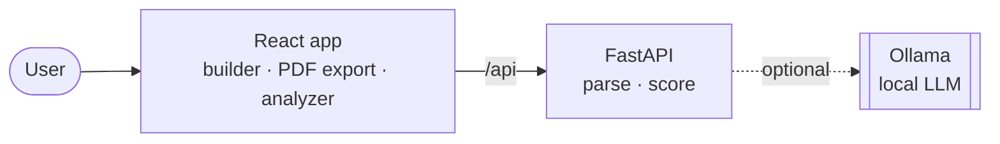

<div align="center">

# 📄 ATS Resume Maker

**Build an ATS-friendly resume and score it against any job description, for free and fully on your own machine.**

[](https://github.com/Omkar123puri5678/ATS/actions/workflows/ci.yml)
[](LICENSE)
[](CONTRIBUTING.md)
<br/>


-000000?logo=ollama&logoColor=white)

[Getting started](#getting-started) · [User Guide](docs/USER_GUIDE.md) · [Architecture](docs/ARCHITECTURE.md) · [Report a bug](https://github.com/Omkar123puri5678/ATS/issues/new?template=bug_report.yml) · [Request a feature](https://github.com/Omkar123puri5678/ATS/issues/new?template=feature_request.yml)

</div>

---

An open-source resume builder with an AI-powered ATS (Applicant Tracking System) analyzer.
Build an ATS-friendly resume, export it as a PDF, and score any resume against a job description,
all without paid APIs. AI features run on **local open-source models** through [Ollama](https://ollama.com),
so your resume never leaves your machine.

> 🔒 **Private by design:** no accounts, no tracking, no third-party AI APIs. Uploaded resumes are
> processed in memory and never written to disk.

## Contents

- [Features](#features)
- [Documentation](#documentation)
- [How the scoring works](#how-the-scoring-works)
- [Tech stack](#tech-stack)
- [Getting started](#getting-started)
- [Configuration](#configuration)
- [API](#api)
- [Project structure](#project-structure)
- [Roadmap](#roadmap)
- [Contributing](#contributing)

## Features

**Resume Builder**
- Guided form for personal details, summary, experience, projects, education, skills and certifications
- Live PDF preview with 3 ATS-friendly templates (Classic, Modern, Compact)
- One-click PDF export with real, selectable text (no images, tables or columns that confuse ATS parsers)
- Autosaves to your browser

**ATS Analyzer**
- Upload a resume (PDF, DOCX or TXT) or analyze the one you just built
- Overall ATS score (0–100) with a per-category breakdown
- Keyword match against a job description: see which keywords you have and which you're missing
- Checks for standard section headings, contact info, action verbs, quantified results and length
- Prioritized list of what to fix

**AI suggestions (optional, local)**
- **Upload & rebuild:** upload your existing resume (any layout) and the AI extracts every section and rebuilds it in the builder as a clean, ATS-friendly resume, optionally tailored to a job description, with the ATS score before and after
- Rewrites weak bullet points with action verbs and measurable impact
- Writes a professional summary from your resume
- Powered by any Ollama model (default: `llama3.2`). The rest of the app works fine without it.

## Documentation

| Doc | What's inside |
|---|---|
| [User Guide](docs/USER_GUIDE.md) | Step-by-step: build a resume, check your score, read the report, AI setup, troubleshooting |
| [Architecture](docs/ARCHITECTURE.md) | Block diagram, components, scoring engine, API, deployment, design decisions |
| [Workflows](docs/WORKFLOW.md) | User journey and sequence diagrams for every flow, plus the development workflow |
| [Developer Guide](docs/DEVELOPER_GUIDE.md) | Setup, configuration, adding skills/templates/checks, testing, CI, Docker, releasing |

## Architecture at a glance



PDFs are generated in the browser; the backend only parses and scores. See
[docs/ARCHITECTURE.md](docs/ARCHITECTURE.md) for the full block diagram.

## How the scoring works

The score is a weighted sum of six checks, all computed offline with open-source tools:

| Check | Weight | How |
|---|---|---|
| Keyword match | 35 | Skills and frequent terms from the job description, matched with synonyms and word forms (Postgres = PostgreSQL, tests = testing). Skills shown in experience or projects earn full credit, skills only in a skills list earn 60%, and nice-to-have requirements count half |
| Content relevance | 10 | TF-IDF cosine similarity (scikit-learn) between resume and job description |
| Sections | 20 | Detects standard headings: Experience, Education, Skills (+ Summary, Projects, Certifications) |
| Contact info | 10 | Email, phone, LinkedIn/GitHub/portfolio link |
| Impact | 15 | Share of bullet points that start with an action verb and include numbers |
| Length | 10 | 300–1000 words is ideal |

Without a job description, the keyword and relevance checks are skipped and the other weights are rescaled.
Lines copied word-for-word from the job description are ignored (keyword stuffing), and vague bullets
("improved various things") get no impact credit even with a verb and a number.
See [`backend/app/scorer.py`](backend/app/scorer.py).

## Tech stack

- **Frontend:** React, Vite, Tailwind CSS, `@react-pdf/renderer`
- **Backend:** Python, FastAPI, pdfplumber, python-docx, scikit-learn
- **AI:** Ollama (Llama 3.2, Mistral, Qwen or any other local model)

## Getting started

### Desktop app for Windows (no setup)

Download `ATS-Resume-Maker-windows.zip` from the [Releases](https://github.com/Omkar123puri5678/ATS/releases)
page, unzip it anywhere and double-click **ATS Resume Maker.exe**. It opens in its own window, like
any other program. You don't need Python, Node.js or a browser, and nothing goes online. Your resume
autosaves between launches. If [Ollama](https://ollama.com) is installed on the PC, AI suggestions
work too.

> Windows SmartScreen may warn that the app is from an unknown publisher, because it isn't
> code-signed. Click **More info → Run anyway**.

To build it yourself (needs Python 3.10+ and Node.js 20+, with `backend/.venv` set up as in Option 2):

```powershell
powershell -ExecutionPolicy Bypass -File desktop\build.ps1
```

The app is written to `desktop\dist\ATS Resume Maker\`, and a zip ready to share is written next to it.
[`desktop/ats_app.py`](desktop/ats_app.py) starts the FastAPI backend in the background and shows the
React app in a native WebView2 window ([pywebview](https://pywebview.flowrl.com)), packaged with PyInstaller.

### Option 1: Docker (easiest)

```bash
docker compose up --build
```

Open http://localhost:8080.

### Option 2: Run locally

**Requirements:** Python 3.10+, Node.js 20+

```bash
# Backend
cd backend
python -m venv .venv
# Windows: .venv\Scripts\activate    macOS/Linux: source .venv/bin/activate
pip install -r requirements.txt
uvicorn app.main:app --reload --port 8000
```

```bash
# Frontend (in a second terminal)
cd frontend
npm install
npm run dev
```

Open http://localhost:5173.

### Try it with sample resumes

[`samples/`](samples/README.md) has fictional resumes (strong, average, weak, fresher, non-tech) in PDF,
DOCX and TXT, plus job descriptions to paste in. `python samples/score_all.py` scores them all in one table.

### Enable AI suggestions (optional)

1. Install [Ollama](https://ollama.com/download)
2. Pull a model: `ollama pull llama3.2`
3. Restart the app. The header badge changes from **AI: off** to **AI: llama3.2**.

To use a different model, set `OLLAMA_MODEL` (e.g. `OLLAMA_MODEL=mistral`) before starting the backend.

## Configuration

| Variable | Default | Description |
|---|---|---|
| `OLLAMA_URL` | `http://localhost:11434` | Where Ollama is running |
| `OLLAMA_MODEL` | `llama3.2` | Model used for suggestions |
| `CORS_ORIGINS` | `http://localhost:5173` | Comma-separated allowed origins |

## API

Interactive docs are at http://localhost:8000/docs when the backend is running.

| Method | Endpoint | Description |
|---|---|---|
| GET | `/api/health` | Backend status and AI availability |
| POST | `/api/analyze` | Analyze an uploaded file (`file`, optional `job_description`) |
| POST | `/api/analyze-text` | Analyze plain text (`resume_text`, `job_description`) |
| POST | `/api/ai/rewrite-bullets` | Rewrite bullet points with the local LLM |
| POST | `/api/ai/summary` | Generate a professional summary |
| POST | `/api/ai/build-resume` | Multipart `file` (+ optional `job_description`) → resume rebuilt in the builder's format, plus `score_before` / `score_after` |

## Project structure

```
.github/
  workflows/ci.yml   Tests and build on every push / PR
  ISSUE_TEMPLATE/    Bug report and feature request forms
  dependabot.yml     Weekly dependency update PRs
docs/                      User guide, architecture, workflows, developer guide
backend/
  app/
    main.py        FastAPI routes
    parser.py      PDF / DOCX / TXT text extraction
    scorer.py      ATS scoring engine
    skills.py      Skill vocabulary and action verbs (easy to extend)
    llm.py         Ollama integration
  tests/
frontend/
  src/
    builder/       Resume form, templates, PDF rendering (lazy-loaded), live preview
    analyzer/      Upload, scoring report, AI rewrites
    resume.js      Resume data model
```

## Running tests

```bash
cd backend
pytest
```

## Roadmap

- [ ] More templates
- [ ] Import an existing resume into the builder
- [ ] Semantic keyword matching with local embeddings (sentence-transformers)
- [ ] Cover letter generator
- [ ] Multi-language support

## Contributing

Contributions are welcome! See [CONTRIBUTING.md](CONTRIBUTING.md) and the
[Code of Conduct](CODE_OF_CONDUCT.md).
A good first contribution is adding skills for your field to [`backend/app/skills.py`](backend/app/skills.py).

Found a security issue? Please report it privately. See [SECURITY.md](SECURITY.md).
Release notes are in [CHANGELOG.md](CHANGELOG.md).

## License

Released under the [MIT License](LICENSE).

<div align="center">

If this project helps you land an interview, consider giving it a ⭐

</div>
