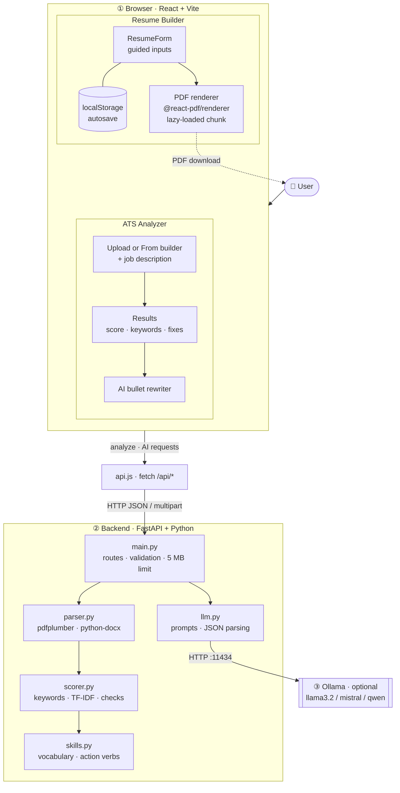
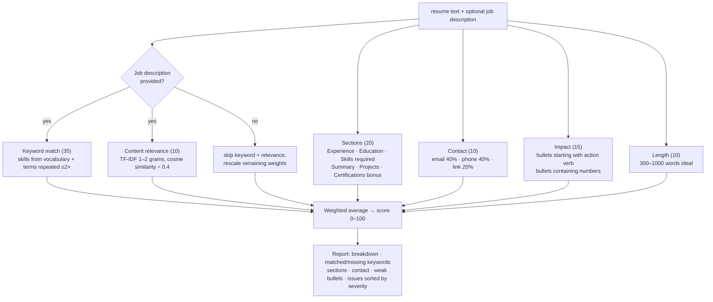
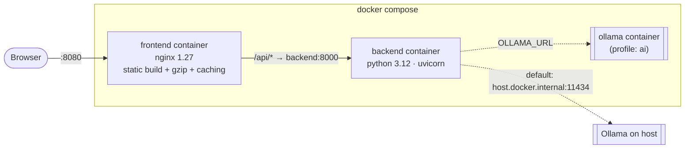

# Architecture

ATS Resume Maker is a two-part web app: a **React single-page app** that builds resumes and renders
PDFs entirely in the browser, and a **FastAPI service** that parses and scores resumes. An optional
**Ollama** server provides AI suggestions from a local open-source model. Nothing is stored on the
server and no paid or external API is called.

## Block diagram

## Components

### Frontend (`frontend/src`)

| Module | Responsibility |
|---|---|
| `main.jsx`, `App.jsx` | Mounts the app, renders the two tabs, calls `/api/health` once to show backend and AI status. Both tabs stay mounted so form data and results survive tab switches. |
| `resume.js` | The resume data model (`sampleResume`, `blankResume`), `lines()` helper, and `resumeToText()` which flattens the resume into plain text for scoring. |
| `builder/Builder.jsx` | Holds resume + template state, autosaves to `localStorage`, debounces PDF previews (500 ms), handles download and AI summary. |
| `builder/ResumeForm.jsx` | Controlled form for personal info, summary, experience, projects, education, skills, certifications. |
| `builder/templates.js` | Template metadata (fonts, accent colour, alignment). Kept separate so the UI can list templates without loading the PDF library. |
| `builder/ResumePDF.jsx` | The PDF document built with `@react-pdf/renderer` primitives. All templates are single-column with real text. |
| `builder/renderPdf.jsx` | Turns the resume into a PDF `Blob`. Loaded with a dynamic `import()` so the ~1.2 MB PDF library is a separate chunk. |
| `analyzer/Analyzer.jsx` | Upload (drag and drop) or "from builder" input, job description, calls the API, shows weak bullets and the AI rewriter. |
| `analyzer/Results.jsx` | Score ring, per-category breakdown, matched/missing keywords, prioritized issues, detected sections. |
| `api.js` | Thin `fetch` wrapper. All requests go to the relative path `/api`, proxied by Vite in development and nginx in Docker. |

### Backend (`backend/app`)

| Module | Responsibility |
|---|---|
| `main.py` | FastAPI app, CORS, request models (Pydantic), 5 MB upload limit, maps errors to HTTP status codes (413, 415, 422, 503). CPU-bound work runs in a worker thread. |
| `parser.py` | Extracts text: PDF via `pdfplumber`, DOCX via `python-docx` (paragraphs and tables), TXT decoded as UTF-8. |
| `scorer.py` | The rule-based ATS engine. Pure function `analyze(resume_text, job_description) -> dict`. No network, no model. |
| `skills.py` | `SKILLS` vocabulary, `ACTION_VERBS`, and `JD_NOISE` (job-posting filler words to ignore). Easy to extend. |
| `llm.py` | Talks to Ollama's `/api/generate` with `format: "json"`, builds prompts for bullet rewrites and summaries, and tolerates malformed model output. |

## Scoring engine

Notes:
- Keyword matching uses custom word boundaries so `c++`, `c#` and `node.js` match correctly, and
  prefers the longest form (`spring boot` over `spring`).
- Section detection only looks at short lines (≤ 5 words) so a sentence that mentions "experience"
  is not mistaken for a heading.
- If no bullet markers are found (some PDF exports strip them), sentence-like lines are used instead,
  skipping `Label: a, b, c` skill lines and `Name | tech` headers.

## API

| Method | Endpoint | Request | Response |
|---|---|---|---|
| GET | `/api/health` | none | `{status, ai: {available, model, models}}` |
| POST | `/api/analyze` | multipart: `file`, `job_description` | report + `resume_text` |
| POST | `/api/analyze-text` | JSON: `resume_text`, `job_description` | report |
| POST | `/api/ai/rewrite-bullets` | JSON: `bullets` (1–15), `job_description` | `{rewrites: [{original, improved}]}` |
| POST | `/api/ai/summary` | JSON: `resume_text`, `job_description` | `{summary}` |

Errors: `413` file over 5 MB, `415` unsupported file type, `422` unreadable file or invalid body,
`503` Ollama unavailable. Interactive docs: `http://localhost:8000/docs`.

## Deployment

- **Development:** Vite dev server on `:5173` proxies `/api` to uvicorn on `:8000`.
- **Docker:** the frontend image is a multi-stage build (Node builds `dist/`, nginx serves it).
  nginx proxies `/api/` to the backend, gzips text assets, caches hashed `/assets/*` for a year and
  sends `no-cache` for `index.html` so new deploys show up immediately.
- **AI:** by default the backend talks to Ollama on the host machine. Run with `--profile ai` and
  `OLLAMA_URL=http://ollama:11434` to use the bundled Ollama container instead.

## Design decisions

| Decision | Why |
|---|---|
| PDFs are rendered in the browser | No server-side PDF dependency, instant preview, the resume never has to be uploaded to be exported. |
| Single-column templates, standard fonts, real text | These are what ATS parsers read reliably. Tables, columns, icons and images often get scrambled. |
| Rule-based scoring instead of an LLM | Deterministic, explainable, fast (~8 ms), and works with no model installed. |
| AI is optional and local | Free, private, and the app degrades gracefully: the badge shows "AI: off" and everything else works. |
| PDF library lazy-loaded | It is ~85% of the JavaScript. Splitting it cut the initial download from 1.45 MB to 246 KB. |
| Parsing and scoring in a worker thread | Keeps the async event loop free, so one large PDF does not block other requests. |
| No database | Resumes are processed in memory and discarded. Autosave lives in the user's own browser. |
