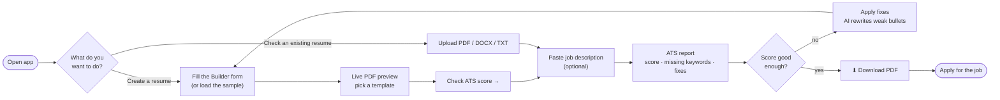
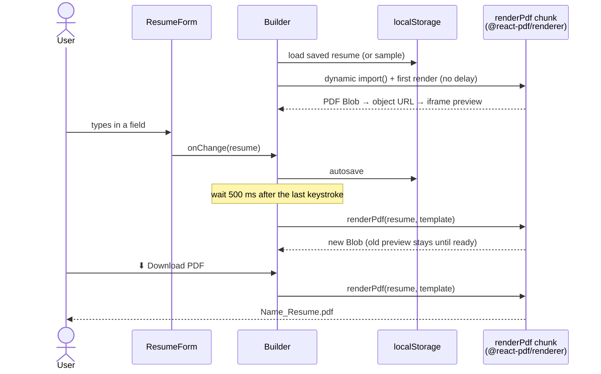
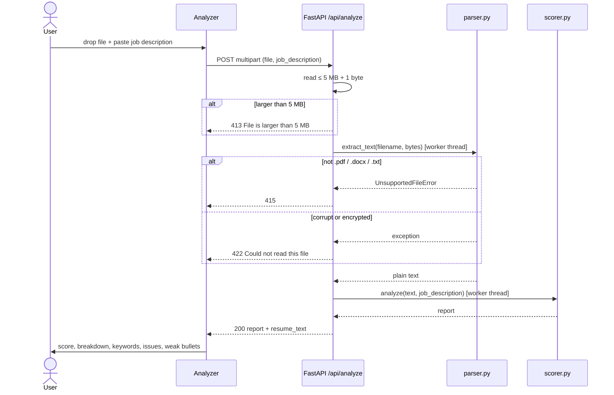
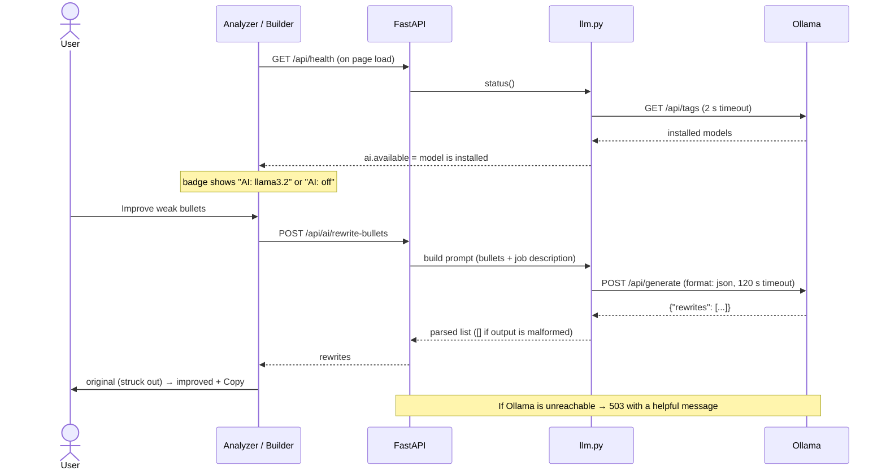
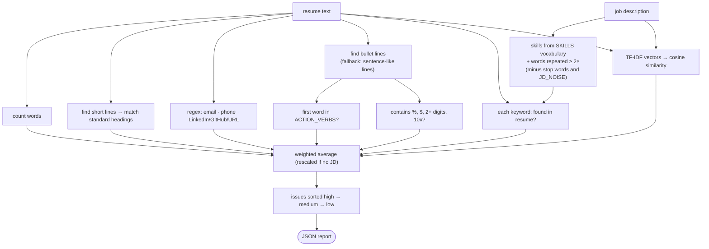
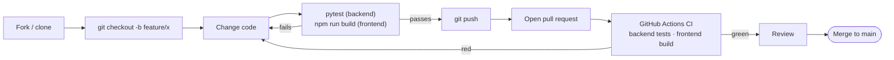

# Workflows

How data moves through the app for each thing a user can do, plus the development workflow.
For the component overview, see [ARCHITECTURE.md](ARCHITECTURE.md).

## Overall user journey

## 1. Building a resume and exporting the PDF

Everything in this flow happens in the browser. The backend is not needed.

## 2. Analyzing an uploaded resume

"From builder" works the same way, except the builder's text (from `resumeToText()`) is sent as JSON
to `POST /api/analyze-text`, so no file parsing happens.

## 3. AI bullet rewrites and summaries (optional)

The model is told never to invent numbers; it uses placeholders like `[X%]` for you to fill in.
"✨ Write with AI" next to the summary field follows the same path via `POST /api/ai/summary`.

## 4. Scoring pipeline

## Development workflow

CI is defined in [`.github/workflows/ci.yml`](../.github/workflows/ci.yml) and runs on every push and
pull request to `main`.
